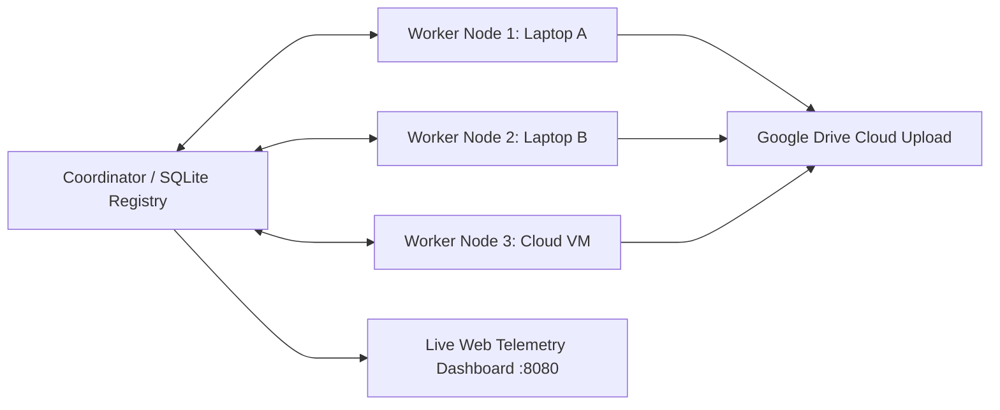

# Andhra Pradesh Distributed Electoral & Rural GP Processing Engine
**Version:** 1.0.0  
**Target:** 175 Assembly Constituencies (~13,300 Gram Panchayats), Andhra Pradesh  

---

## Architecture

This platform distributes electoral roll acquisition, data cleansing, and storage across multiple machines (laptops, desktops, cloud VMs) with centralized telemetry and automated Google Drive synchronization.



### Components:
* **`core/db.py`**: SQLite database registry tracking all 175 ACs, Gram Panchayats, leases, and worker nodes.
* **`core/gdrive_sync.py`**: Automated cloud uploader wrapping the `gdrive` CLI.
* **`worker/worker_node.py`**: Node agent that leases AC batches, manages local `.jsonl` stream checkpoints, and runs multi-threaded requests.
* **`dashboard/dashboard_server.py`**: Lightweight live web monitoring dashboard reporting cluster throughput and constituency progress.

---

## Setup & Multi-Machine Deployment

### 1. Master Machine / Server:
Initialize the database and start the dashboard:
```bash
py core/db.py
py dashboard/dashboard_server.py
```

Expose the dashboard to your mobile or external machines using Cloudflare Tunnel:
```bash
cloudflared tunnel --url http://127.0.0.1:8080
```

### 2. Adding Additional Laptops or Servers (Workers):
Clone the repository onto any machine and start the worker node:
```bash
git clone <YOUR_GITHUB_REPO_URL>
cd ap_election_distributed_engine
py worker/worker_node.py --node-id "laptop-vamsi-2" --workers 24
```
Each machine immediately claims unassigned constituencies, streams checkpoints, and pushes finished bundles to Google Drive.
